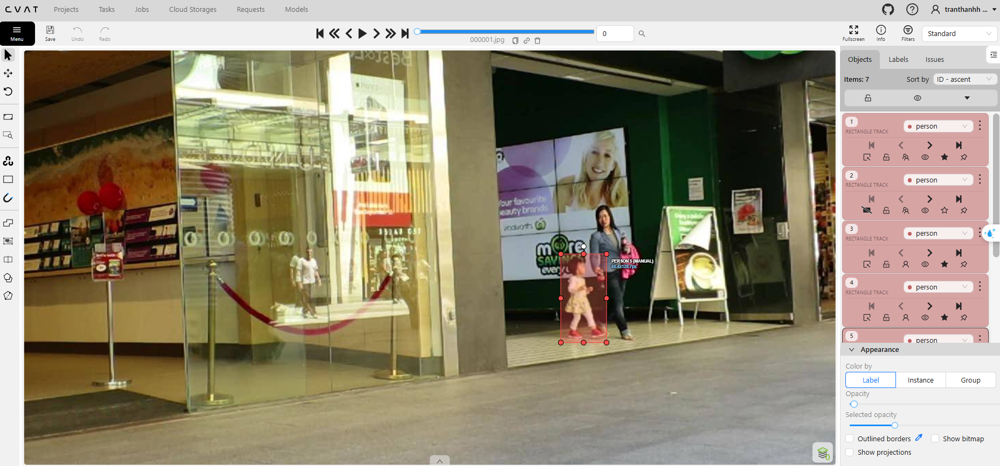
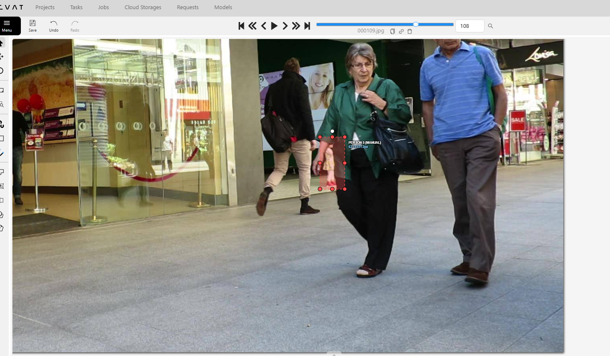
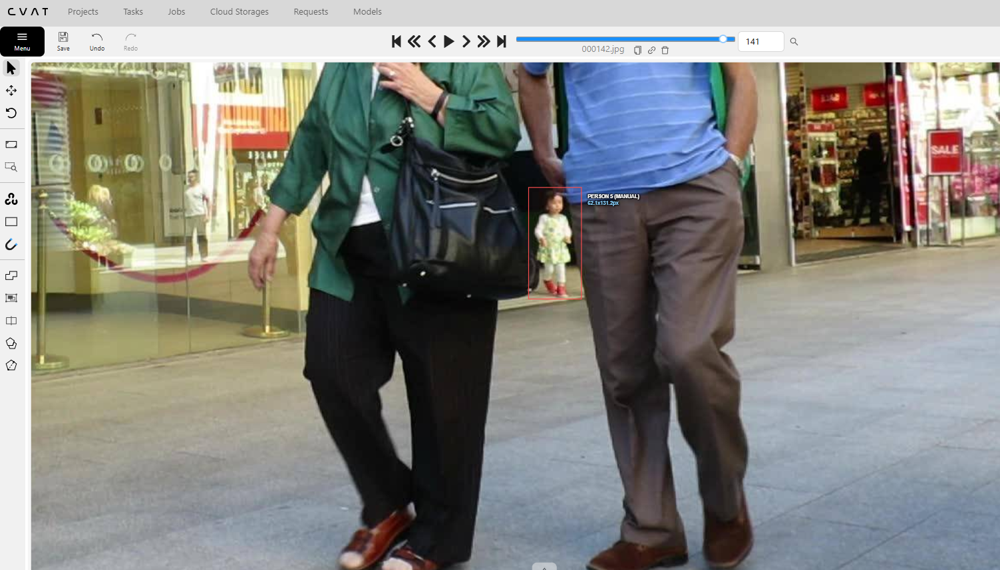

# Báo cáo cá nhân — HoVaTen-MSSV

Đổi tên file theo quy tắc `MSSV_HoTen.md`. Ví dụ: `20241234_NguyenVanAn.md`.

Đoạn video: MOT17-09, 150 frame (frame 1–150), nguồn MOTChallenge, giấy phép CC BY-NC-SA 3.0.

## 0. Thông tin học viên

- Họ tên: Trần Thành Hùng
- MSSV:2A202603247
- Mã đề (A/B/C):De A 
- Email:
- Link repository:https://github.com/Hung-1812/K5-L2-DAY05-TranThanhHung-2A202603247-MOTTracking/tree/main
- Giờ bắt đầu: 16h
- Giờ kết thúc: 19h30

## 1. Xem trước đoạn video (CP0)

Ghi **trước khi vẽ**, mỗi người một dòng.

| Mã | Frame xuất hiện | Frame cuối thấy được | Rẽ / dừng / đổi tốc độ ở frame | Bị che ở frame | Ghi chú |
|---|---|---|---|---|---|
| P1 | 0 | 149 | 149 | | |
| P2 | 61 | 149 | 149 | | |
| P3 | 0 | 149 | 149 | | |
| P4 | 40 | 149 | 149 | | |
| P5 | 0 | 146 | 149 | 105 | |

## 2. Keyframe và thời gian (CP1, CP4)

Số keyframe lấy từ kết quả `src/check_submission.py`.


### 2. Keyframe và thời gian

| Mã | Số keyframe | Keyframe ở frame | Số frame có mặt | Keyframe / 100 frame | Thời gian (phút) | Chỗ khó |
|---|---:|---|---:|---:|---|---|
| P1 (track 0) | 28 | 0, 10, 15, 20, 40, 45, 50, 55, 56, 60, 61, 65, 70, 74, 79, 89, 94, 95, 97, 100, 109, 114, 119, 124, 134, 139, 144, 149 | 150 | 18.7 |  |  |
| P2 (track 1) | 19 | 61, 70, 74, 79, 84, 89, 94, 95, 97, 98, 100, 109, 114, 119, 129, 134, 139, 144, 149 | 89 | 21.3 |  |  |
| P3 (track 2) | 31 | 0, 5, 10, 15, 20, 25, 30, 35, 40, 45, 50, 55, 60, 65, 70, 75, 80, 85, 90, 95, 100, 105, 110, 115, 120, 125, 130, 135, 140, 145, 149 | 150 | 20.7 |  |  |
| P4 (track 3) | 32 | 0, 5, 10, 15, 18, 20, 25, 30, 35, 40, 45, 50, 55, 60, 65, 70, 75, 80, 85, 90, 95, 100, 105, 110, 115, 120, 125, 130, 135, 140, 145, 149 | 150 | 21.3 |  |  |
| P5 (track 4) | 13 | 0, 5, 10, 15, 20, 25, 35, 40, 45, 55, 105, 141, 146 | 150 | 8.7 |  |  |
| **Tổng** | **123** | | **689** | **17.9** | | |

P4 có nhiều keyframe nhất: 32


## 3. Đoạn bị che (CP2)

Người bị che: `P5`

| Mốc | Frame |
|---|---:|
| Bắt đầu bị che một phần (bật `occluded`) | 106 |
| Mất hẳn (bật `outside`) | 114 |
| Hiện lại (tắt `outside`) | 135 |
| Thấy rõ trở lại (tắt `occluded`) | 141 |

- Thời gian khuất hẳn: 21 frame 
- Quyết định: giữ cùng ID 
- Lý do (trả lời 3 câu: khuất bao lâu so với 60 frame, ngoại hình có khớp, chỗ hiện lại có đúng hướng và tốc độ): khuất 21 frame so với 60 frame , ngoại hình khớp , chỗ hiện lại đúng hướng và tốc độ


Ảnh chụp màn hình:





## 4. Tự review ID (CP3)

Tôi Không có lỗi

## 5. File xuất và kết quả tự kiểm (CP4)

| Kiểm tra | Kết quả |
|---|---|
| Tên file MOT 1.1 | `TranThanhHung_mot.zip` |
| Tên file CVAT for video 1.1 | `TranThanhHung_cvat_video.zip` |
| Số track ID khác nhau trong `gt/gt.txt` (phải là 5) | 5 track, tổng cộng 689 box — đạt |
| Frame `outside` không có dòng trong `gt.txt` (đúng / sai) |  kết quả kiểm tra ghi nhận 0 lần bật `outside` |
| Job đã completed trên CVAT máy cá nhân | hoàn thành |

Kết quả tự kiểm từ `src/check_submission.py`:

```text
=== Tóm tắt ===
  Lỗi: 0   |   Cảnh báo: 0
  Đạt. Dán phần tóm tắt này vào báo cáo mục 5.


...
```

## 6. Ba câu kết

1. Nếu được gán lại, bạn sẽ đặt keyframe khác ở đâu? Vì sao?

 Nếu được gán lại, tôi sẽ đặt thêm keyframe ngay trước và sau các đoạn người đổi hướng hoặc tốc độ, nhất là nơi box bắt đầu lệch khi nội suy. Tôi cũng sẽ tua từng frame qua đoạn bị che thay vì chỉ đặt keyframe cách đều.


2. Có chỗ nào bạn không chắc "cùng ID hay ID mới"? Bạn đã quyết định và ghi chú thế nào?

   Ở đoạn P1 bị che, tôi quyết định giữ cùng ID vì người xuất hiện lại khớp với mục tiêu ban đầu về ngoại hình, hướng di chuyển và tốc độ; tôi không tạo track mới. Tôi ghi chú các mốc che khuất và dùng cờ `occluded` / `outside` theo phần người còn nhìn thấy.

3. Một lỗi ID trong job của bạn (nếu không còn sót, chọn lỗi đã sửa) có thể làm xe tự lái dự đoán sai chuyển động của người đó như thế nào? Lỗi đó ảnh hưởng MOTA hay IDF1 nhiều hơn?

   Ví dụ, nếu xảy ra `id_switch` ở lúc hai người đi sát nhau, tracker có thể nối vị trí của người này sang người kia, khiến quỹ đạo và hướng di chuyển dự đoán sai. Lỗi này ảnh hưởng trực tiếp đến IDF1 vì sai tính nhất quán danh tính; MOTA cũng bị giảm do tính ID switch.

## Bonus (nếu làm)

### B1 — Hai người đi sát

P6-P8

### B2 — So cách đặt keyframe

| Cách đặt | Số keyframe | Frame trôi nhất | Ghi chú |
|---|---:|---:|---|
| Đều mỗi 30 frame | | | |
| Theo chỗ đổi hướng | | | |


### B3 — So với tracker có sẵn

| Frame | Mã người | Tracker làm gì | Nhãn của bạn | Giải thích (đoán rồi sửa / ghép IoU / box score thấp / ngoại hình) |
|---:|---|---|---|---|
| | | | | |
| | | | | |

## 7. Tài liệu tham khảo và công cụ AI đã dùng


